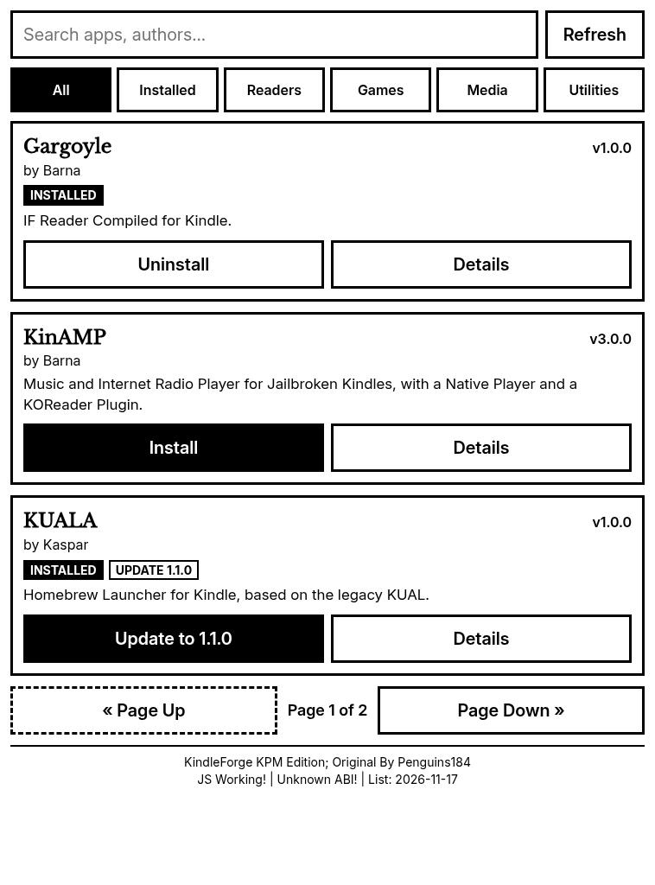
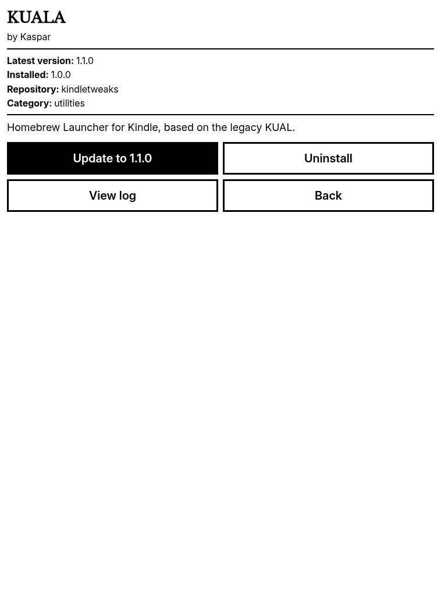

# KindleForge 📦

> [!NOTE]
> **KPM Edition.** A fork of [KindleTweaks/KindleForge](https://github.com/KindleTweaks/KindleForge) by Penguins184. The backend now delegates all package work to the native [KPM](https://github.com/KindleModding/KPM) CLI and reads live KPM repositories (default: [KindleTweaks/Repo](https://kindletweaks.github.io/Repo/manifest.json)), and the UI is rebuilt for e-ink. **Requires a KPM on the device**: either [KindleModding/KPM](https://github.com/KindleModding/KPM) (ships with `hdnext` / jb.sh) or [gingrspacecadet/kpm](https://github.com/gingrspacecadet/kpm); KindleForge detects which one is installed. **Pre-release: not yet tested on real hardware**, see [TESTING.md](TESTING.md).

KindleForge is a GUI Appstore for Kindles, allowing you to download & install tweaks & applications such as KOReader directly on-device, without having to keep copying files locally.

## Installation

> [!CAUTION]
> Ensure you are on the latest hotfix prior to installation! Older hotfixes could potentially cause bricks! As always, jailbreak at your own risk ;) **Hotfixes 2.3.1 and above should work fine.**

1. Download the zip from the [latest release](https://github.com/ZachCurry13/KindleForge/releases/latest) and unzip it.
2. Copy `KindleForge/` and `KindleForge.sh` into the `documents/` folder on your Kindle.
3. Run the scriptlet, then tap *Refresh* in the app.

Full instructions, including updating and removing: [INSTALL.md](INSTALL.md).

## Features

- Installs through the native KPM package manager
- Search, category tabs and Install / Update / Uninstall buttons
- Paginated, high-contrast e-ink UI (no scrolling, no animation)
- Multiple repositories, with an offline cache. The catalog definition updates from GitHub without a new app release
- **Both package repositories in one store:** the gingrspacecadet/kpm packages, and the KindleTweaks repository (KUALA, Gargoyle, KinAMP, LARK, RAnki), which KindleForge installs itself, with real version tracking and Update buttons
- **Always up to date:** the list refreshes by itself when it is more than a day old, and the footer says how old it is
- **Suggest an app:** anyone can suggest one on GitHub ([how](CONTRIBUTING.md), [what people want](SUGGESTIONS.md)); accepted apps are reviewed by hand and pinned to a checksum
- **Anonymous ratings:** rate packages you installed (1-5); averages show on the cards once a package has enough votes. See [ratings-worker](ratings-worker/README.md) for what is stored.
- **Clean Up Kindle** (menu): scans for crash dumps and leftovers, you choose what to move to a restorable trash; fixed allowlist, never touches your books
- In-app self-update from GitHub releases, with checksum verification and rollback
- Hard-float and soft-float support

 

*Desktop-browser renders at 758x1024; not photos of a Kindle.*

## Minimum Requirements

- A jailbroken Kindle (AdBreak, WinterBreak, LanguageBreak, ...) with **a KPM installed** (KindleModding/KPM or gingrspacecadet/kpm)
- Latest Universal Hotfix
- Above or on the 5.12.2.2 firmware (4.1.0 adds Chromebar fixes; Application Errors fixed with Hotfix 2.3.7+)
- Both **hard-float and soft-float** kindles should work, but not all packages may support both architectures.

## Troubleshooting

Try reloading multiple times, rebooting, or re-copying the files from the latest release and trying again.

Problems with this fork: open an [issue](https://github.com/ZachCurry13/KindleForge/issues). The original project's community: [discord](https://discord.gg/aSG3eMsAsW).

### Hotfix

Reinstallation steps:

1. Turn on aeroplane mode
2. Restore OTAs
3. Download latest hotfix from wiki, copy to kindle root
4. Update your kindle 
5. Run the hotfix
6. Rename OTAs
7. You can use WiFi once more

### KindleForge

**Q: The KindleForge scriptlet doesn't appear!**

A: Ensure you have copied `KindleForge.sh` into your documents folder. If this is true, and the scriptlet still isn't showing, then reinstall the latest hotfix using the steps above.

**Q: When I click on the scriptlet, it says "Application Error!"**

A: Chances are, you've installed KindleForge incorrectly. **BOTH the folder AND scriptlet MUST be in the `documents` folder on your kindle!**. If you are on an elder firmware this is a usually harmless popup and the app will open regardless - this is being investigated.

**Q: I keep getting core dumps & crashlogs generated when using KindleForge/Scriptlets!**

A: You must be on the latest hotfix, 2.3.1+. Use the steps mentioned above to reinstall hotfix

**Q: No apps load!**

A: Tap *Refresh* (needs Wi-Fi once). Check that KPM exists at `/var/local/kmc/bin/kpm`, and look at `/mnt/us/.KFPM/last-log.txt` (also viewable in-app via *Details > View log*).

**Q: App is installing/uninstalling forever!**

A: Could be caused by a multitude of issues such as beginning the install without wifi, DNS stuff. Press *Refresh* to clear the lock and retry, or reboot. Operations time out after 5 minutes.

## Repositories & data

KFPM keeps its data in `/mnt/us/.KFPM/`:

- `repos.json` - your own extra repos / category overrides / `disable` list (merged over the GitHub catalog definition, never overwritten)
- `update.json` - installed version and any pending KindleForge update
- `cache/config.json` - last good copy of the GitHub catalog definition (`catalog/config.json` in this repo)
- `catalog.json` - merged catalog the UI reads (rewritten by KFPM)
- `cache/` - last good copy of each manifest, used when offline
- `last-log.txt` - output of the most recent operation

## Building & Contribution

```
cd KFPM
GOOS=linux GOARCH=arm GOARM=7 CGO_ENABLED=0 go build -trimpath -ldflags="-s -w" -o ../KindleForge/KindleForge/binaries/KFPM .
upx --best --lzma ../KindleForge/KindleForge/binaries/KFPM   # optional: ~7MB -> ~1.6MB
```

Desktop testing: set `KFPM_DATA_DIR`, `KFPM_KPM`, `KFPM_DB` and `KFPM_PLATFORM` to point KFPM at a fake `kpm` and a test database. The frontend loads data from `./dev/` when not served from `file://`.

KindleForge is licensed under `GPLv3`, with all other KindleTweaks projects (including the KindleForge Repository) being licensed under `CC BY-NC-SA 4.0`.

## Special Thanks

- [Kurizu](https://ko-fi.com/kurizu), Illusion help & app image
- Gingrspacecadet, KFPM, inspiration & repository help
- Clint, event & KFPM troubleshooting, scroll help
- Dammit Jeff, repository icons
- ThatPotatoDev, ABI differentiation, dependencies, & tweak support
